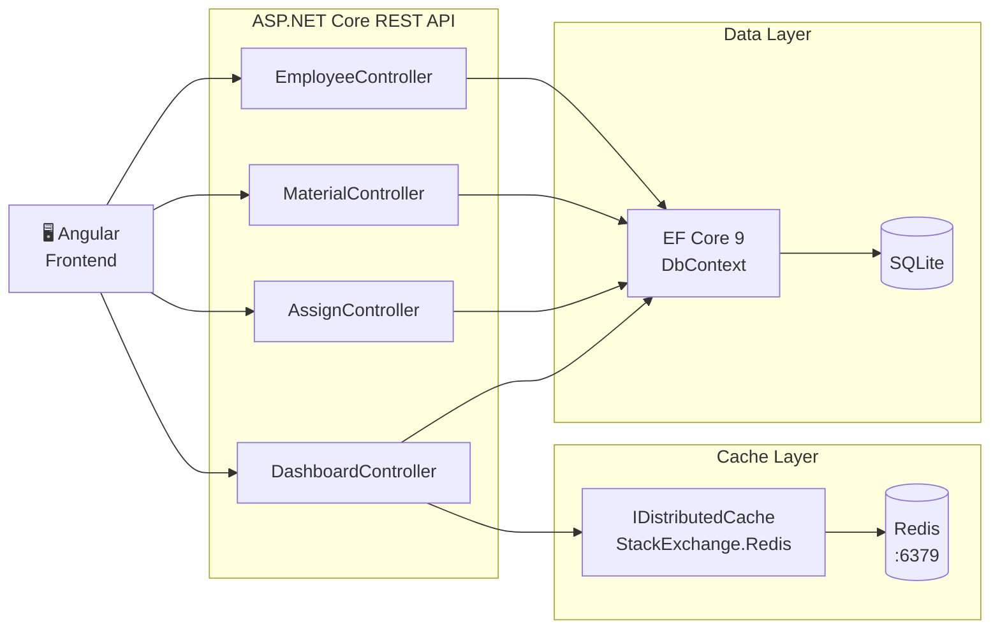
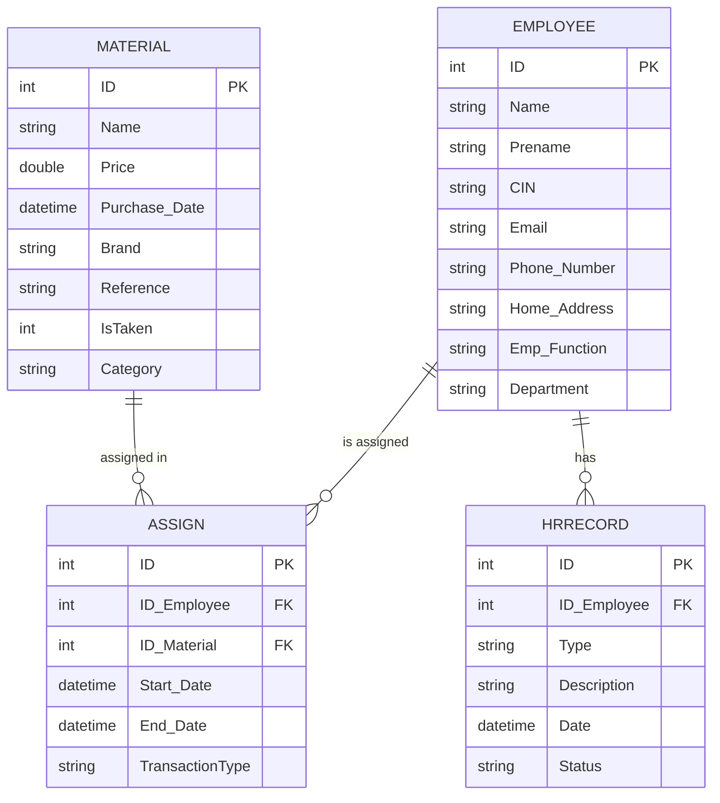
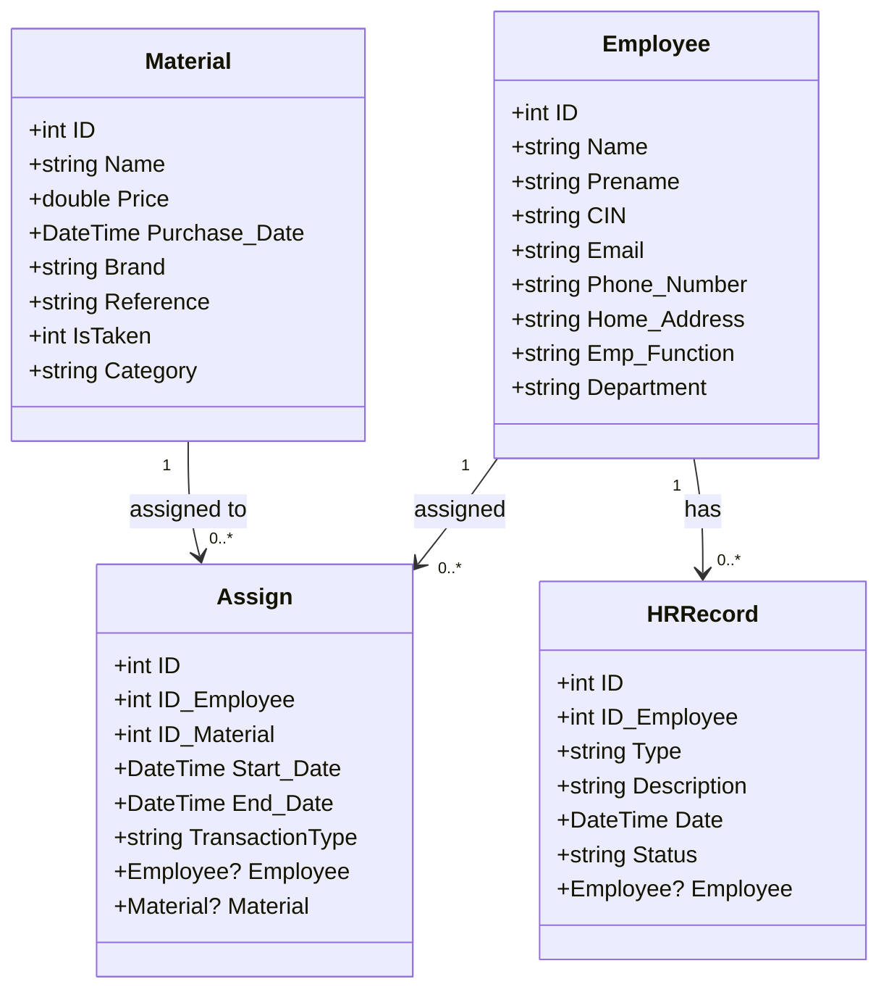
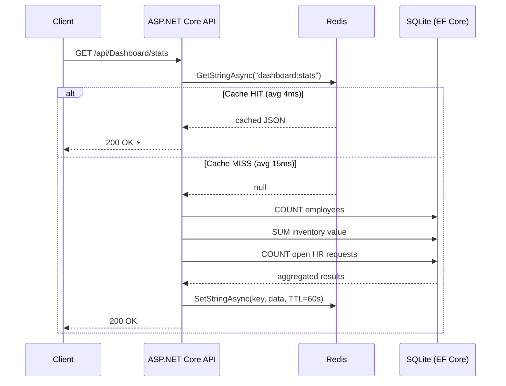
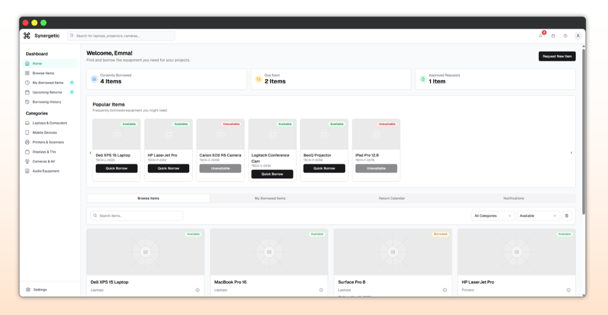

<p align="center">
  
</p>

# ERM Platform — AHEADIT Group

> **Employee Resource Management** app I built as an intern at AHEADIT Group (January–February 2023), then rebuilt in 2026.
> It manages employee records, equipment inventory, material assignments and HR records.

---

## History: 2023 internship → 2026 rebuild

**This repository is the 2026 rebuild of the backend.** The code I wrote during the internship is kept unchanged in two repositories:

- [Enterprise-Resource-Management-System](https://github.com/Yassinekrn/Enterprise-Resource-Management-System): the 2023 backend and frontend
- [CRUD-Web-App-Material-Managment-Front-End](https://github.com/Yassinekrn/CRUD-Web-App-Material-Managment-Front-End): the 2023 Angular frontend on its own

| | 2023 (internship) | 2026 (rebuild, this repo) |
| --- | --- | --- |
| Runtime | .NET 6 | .NET 10 |
| ORM | EF Core 7 | EF Core 9 with migrations |
| Database | SQL Server Express, schema run by hand from [`tables.sql`](legacy-2023/tables.sql) | SQLite, created and seeded on first run |
| API | Employee, Material, Assign, Login controllers | same, plus a Dashboard controller and HR records |
| Caching | none | Redis cache-aside on the dashboard endpoints (60 s TTL) |
| Seed data | none | Bogus, deterministic (seed 42) |
| API docs | Swashbuckle 6 | Swashbuckle 7 |
| Frontend | Angular 15 | the 2023 Angular 15 frontend, not migrated |

What the rebuild measured ([raw data](measurements/METRICS.md)):

- **N+1 fix:** the assignment details endpoint went from 313 queries per request to 1 (eager loading with `Include`).
- **Redis caching:** dashboard endpoints answer up to 3.8× faster warm than cold (15.2 ms → 4.0 ms on `/api/Dashboard/stats`).

> **About the commit dates:** the rebuild was written in June 2026, but its commits were dated to the internship period (January–February 2023) when they were pushed. The EF migration name (`20260612…_Init`) shows the real date. For code actually written in 2023, see the two repositories above.

---

## Tech Stack

| Layer     | Technology                                              |
| --------- | ------------------------------------------------------- |
| Backend   | ASP.NET Core 10 (C#) · Entity Framework Core 9 · SQLite (2026 rebuild) |
| Caching   | Redis · StackExchange.Redis · `IDistributedCache`       |
| Seed data | Bogus                                                   |
| Frontend  | Angular 15 · TypeScript (2023, separate repository) |
| API Docs  | Swagger / OpenAPI                                       |

---

## Features

- **Employee directory** — full CRUD for employee records with department classification
- **Inventory management** — track equipment and supplies by category, brand, price, and availability
- **Assignment tracking** — link employees to equipment with transaction types (Purchase / Assignment / Return)
- **HR records** — log leave requests, performance notes, warnings, and promotions per employee
- **Dashboard aggregates** — real-time summary stats, inventory value by category, headcount by department
- **Redis caching** — dashboard endpoints cached with 60-second TTL using cache-aside pattern
- **Optimized queries** — eager loading via EF Core `Include()` eliminates N+1 patterns

---

## Architecture



---

## Data Model

### Entity-Relationship Diagram



### Class Diagram



---

## Backend Structure

```
Admin_GM/
├── Controllers/
│   ├── EmployeeController.cs    # CRUD: employee records
│   ├── MaterialController.cs    # CRUD: inventory items
│   ├── AssignController.cs      # CRUD + eager-loaded detail view
│   ├── DashboardController.cs   # Cached aggregate endpoints
│   └── LoginController.cs
├── Models/
│   ├── Employee.cs              # + Department field
│   ├── Material.cs              # + Category field
│   ├── Assign.cs                # + Navigation properties + TransactionType
│   └── HRRecord.cs              # Leave requests & performance notes
├── Data/
│   ├── EmployeeDbContext.cs     # EF Core context + FK relationships
│   └── SeedData.cs             # Bogus-generated test dataset
├── Migrations/                  # EF Core SQLite migration
└── Program.cs                   # DI: SQLite, Redis, EF logging
```

---

## Getting Started

### Prerequisites

- [.NET 10 SDK](https://dotnet.microsoft.com/download)
- [Docker](https://www.docker.com/) (for Redis)
- [Node.js](https://nodejs.org/) + Angular CLI (for frontend)

### Backend

```bash
# 1. Start Redis
docker run -d -p 6379:6379 --name redis-erm redis:alpine

# 2. Restore dependencies
cd Backend/Admin_GM/Admin_GM
dotnet restore

# 3. Run — auto-migrates and seeds on first start
dotnet run
```

API runs at `http://localhost:5000`. Swagger UI at `http://localhost:5000/swagger`.

### Frontend

The frontend is the 2023 Angular 15 app from the internship, kept in [CRUD-Web-App-Material-Managment-Front-End](https://github.com/Yassinekrn/CRUD-Web-App-Material-Managment-Front-End). Clone it, then:

```bash
npm install
ng serve -o
```

---

## API Reference

### Employee

| Method   | Endpoint             | Description        |
| -------- | -------------------- | ------------------ |
| `GET`    | `/api/Employee`      | List all employees |
| `GET`    | `/api/Employee/{id}` | Get employee by ID |
| `POST`   | `/api/Employee`      | Create employee    |
| `PUT`    | `/api/Employee/{id}` | Update employee    |
| `DELETE` | `/api/Employee/{id}` | Delete employee    |

### Material (Inventory)

| Method   | Endpoint             | Description              |
| -------- | -------------------- | ------------------------ |
| `GET`    | `/api/Material`      | List all inventory items |
| `GET`    | `/api/Material/{id}` | Get item by ID           |
| `POST`   | `/api/Material`      | Add inventory item       |
| `PUT`    | `/api/Material/{id}` | Update item              |
| `DELETE` | `/api/Material/{id}` | Remove item              |

### Assignments

| Method   | Endpoint              | Description                                |
| -------- | --------------------- | ------------------------------------------ |
| `GET`    | `/api/Assign`         | All assignments (raw IDs)                  |
| `GET`    | `/api/Assign/details` | Assignments with employee & material names |
| `POST`   | `/api/Assign`         | Create assignment                          |
| `PUT`    | `/api/Assign/{id}`    | Update assignment                          |
| `DELETE` | `/api/Assign/{id}`    | Delete assignment                          |

### Dashboard _(Redis-cached, 60s TTL)_

| Method | Endpoint                                 | Description                                        |
| ------ | ---------------------------------------- | -------------------------------------------------- |
| `GET`  | `/api/Dashboard/stats`                   | Total employees, inventory value, open HR requests |
| `GET`  | `/api/Dashboard/inventory-by-category`   | Item count and value per category                  |
| `GET`  | `/api/Dashboard/employees-by-department` | Headcount per department                           |

---

## Performance

### Cache-Aside Flow



### N+1 Query Elimination

Replacing sequential `FindAsync` calls with `.Include()` in the assignment detail endpoint:

| Endpoint                  | Before          | After       | Reduction |
| ------------------------- | --------------- | ----------- | --------- |
| `GET /api/Assign/details` | **313 queries** | **1 query** | **99.7%** |

### Redis Cache Impact

_5 cold runs (Redis flushed between each) · 5 warm runs_

| Endpoint                                 | Cold (DB) | Warm (Cache) | Speedup  |
| ---------------------------------------- | --------- | ------------ | -------- |
| `/api/Dashboard/stats`                   | 15.2 ms   | 4.0 ms       | **3.8×** |
| `/api/Dashboard/inventory-by-category`   | 7.4 ms    | 3.2 ms       | **2.3×** |
| `/api/Dashboard/employees-by-department` | 10.4 ms   | 3.0 ms       | **3.5×** |

Full raw data → [`measurements/METRICS.md`](measurements/METRICS.md)

---

## Frontend Preview

<p align="center">
  
</p>

---

## Seed Data

Generated with [Bogus](https://github.com/bchavez/Bogus) — deterministic, reproducible (seed = 42).

| Entity          | Count | Distribution                                                                                           |
| --------------- | ----- | ------------------------------------------------------------------------------------------------------ |
| Employees       | 300   | 5 departments: IT, HR, Finance, Operations, Marketing                                                  |
| Inventory items | 500   | 8 categories: Hardware, Software, Furniture, Office Supplies, Electronics, Networking, Vehicles, Tools |
| Assignments     | 200   | 3 types: Purchase, Assignment, Return                                                                  |
| HR records      | 50    | 5 types: Leave Request, Performance Note, Warning, Promotion, Training                                 |

---

## UML Diagrams (PlantUML)

Source files for report-quality diagrams are in [`docs/diagrams/`](docs/diagrams/):

| File                                                       | Description                  |
| ---------------------------------------------------------- | ---------------------------- |
| [`er-diagram.puml`](docs/diagrams/er-diagram.puml)         | Entity-relationship diagram  |
| [`class-diagram.puml`](docs/diagrams/class-diagram.puml)   | Domain model class diagram   |
| [`sequence-cache.puml`](docs/diagrams/sequence-cache.puml) | Cache-aside sequence diagram |
| [`architecture.puml`](docs/diagrams/architecture.puml)     | System component diagram     |

Render with [PlantUML](https://plantuml.com/) or the VS Code PlantUML extension.

---

## License

Originally developed during an internship at **AHEADIT Group** (2023); rebuilt in 2026.
See [LICENSE](LICENSE) for details.
